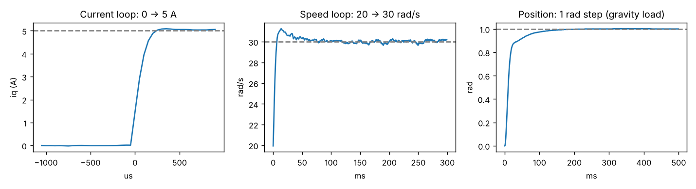

# BLDC FOC Joint Firmware

Firmware for a robot joint actuator: a 7 pole-pair BLDC motor driven with **field-oriented control (FOC)**
on an **STM32G431 (Cortex-M4F) running FreeRTOS**, with hall sensors + an incremental encoder, cascaded
**current / velocity / position / impedance** control, a multi-drop **RS-485 joint bus** (six joints at
1 kHz on one bus), protections, self-commissioning, and a **ROS 2 bridge**.

It is verified **hardware-in-the-loop against a modeled joint** (motor, inverter, DC bus, sensors and
thermal behaviour, simulated at 20 kHz PWM resolution with the real firmware source compiled in). The
target build compiles and links for the STM32G431; **it has not been run on a physical board yet**
(see [docs/BRINGUP.md](docs/BRINGUP.md) for the bench checklist).

## Results (`python -m hil.run_all`: 19/19 scenarios, 65/65 checks)

| What | Result |
|---|---|
| Self-commissioning, 20 modeled units | R within **1.3 %**, L within **2.2 %**, hall edges within **0.76 deg** (elec.), encoder reversal detected; **20/20** units |
| Current loop (0 -> 5 A, 1 kHz bandwidth from measured R, L) | **150 us** rise, **1.7 %** overshoot |
| Speed loop / position loop | 12.5 % overshoot, 34 ms settle / 1 rad step in **110 ms**, holds a gravity load within 1 encoder count |
| Impedance mode (kp = 2 Nm/rad) | measured stiffness **1.985 Nm/rad** (0.75 % error) |
| FOC vs six-step at 30 rad/s | torque ripple **2.9 % vs 7.2 %**; speed ripple at 5 rad/s **0.25 vs 0.69 rad/s**; six-step needs **+6 %** current |
| Overcurrent (shorted switch) | bridge off **1 PWM period** (50 us) after 15 A |
| Braking on a bench supply | bus **36 V -> OVERVOLT trip** without the limit; **29.6 V**, no trip, with the 20 kHz braking limit |
| 10 A stall for 150 s | winding **142 C** derating on the NTC alone vs **104 C** with the winding model |
| Encoder unplugged at 60 rad/s | detected in **2 hall edges (5 ms)**, keeps running on halls at half current |
| Six joints, one 4 Mbaud RS-485 bus, 1 kHz | **12,000/12,000** replies, **0** collisions, cycle **675 us** of 1000 |
| Bus with bit errors (BER 1e-4) | all corrupted frames rejected by CRC; joints unaffected |
| Flying start at 120 rad/s | current spike **0.07 A** (1.3 A with zero-voltage first duties) |
| Parser fuzz | 2,000,000 random bytes and 100,000 frames with 1-3 bit errors: **0** accepted |
| STM32G431 + FreeRTOS build | **18,248 B** flash, **7,656 B** RAM |

Every requirement with its evidence: [docs/REQUIREMENTS.md](docs/REQUIREMENTS.md). What went wrong on the
way and how it was fixed: [docs/FINDINGS.md](docs/FINDINGS.md).



## How it fits together

```
 host (ROS 2 node / jointctl) --RS-485, 4 Mbaud, SYNC_CMD every 1 ms--> joint 1 ... joint N
                                                                         |
 STM32G431 ---------------------------------------------------------------------------------
 ADC IRQ, 20 kHz, prio 0 (never masked)   app_isr: currents -> Clarke/Park -> PI (d,q) + decoupling
                                          -> inverse Park (+1.5 Ts angle advance) -> SVPWM -> TIM1
                                          encoder PLL, hall edges, overcurrent, braking limit
 ctrl task, 1 kHz                         torque | velocity PI | position | impedance -> iq ref
                                          bus voltage, comm timeout -> damping
 comm task, on every RX byte              frame parser (header, length, CRC-16, idle-gap resync)
                                          -> commands, register reads/writes, timed reply slot
 monitor task, 100 Hz                     NTC + winding model -> derating; watchdog kick
```

Details, timing budget and the bus protocol: [docs/DESIGN.md](docs/DESIGN.md).

## Quick start (macOS or Linux)

```bash
cmake -S . -B build && cmake --build build -j
./build/unit_tests
python3 -m pip install -r requirements.txt
python3 -m pytest -q
python3 -m hil.run_all
```

Talk to simulated joints the way you would to real ones through a USB-RS485 adapter:

```bash
./build/pty_sim --joints 2 --link /tmp/jointbus &
python3 tools/jointctl.py --port /tmp/jointbus scan
python3 tools/jointctl.py --port /tmp/jointbus spin 1 --vel 25 --seconds 3
python3 tools/jointctl.py --port /tmp/jointbus hold 2 --kp 1.0 --kd 0.02
```

Cross-build for the STM32G431: run the first line for Arm GCC **or** the second for clang + lld, then the build:

```bash
cmake -S . -B build-arm -DCMAKE_TOOLCHAIN_FILE=cmake/arm-gcc.cmake -DCMAKE_BUILD_TYPE=MinSizeRel
cmake -S . -B build-arm -DCMAKE_TOOLCHAIN_FILE=cmake/arm-clang.cmake -DCMAKE_BUILD_TYPE=MinSizeRel
cmake --build build-arm
```

FreeRTOS-Kernel V11.2.0 is fetched from GitHub at configure time (or pass `-DFREERTOS_KERNEL_PATH=...`).

### ROS 2

`ros2/joint_bus_bridge` is an ament_python package: `/joint_states` out, `~/joint_commands` in
(sensor_msgs/JointState), `/diagnostics`, and `~/enable`, `~/disable`, `~/clear_faults` services. Its logic is
tested here against the simulated bus with a stand-in for rclpy; the CI job `ros2` runs the real node in
`ros:jazzy`. To run it yourself:

```bash
docker run -it --rm -v $PWD:/ws -w /ws ros:jazzy bash
apt-get update && apt-get install -y cmake build-essential ros-jazzy-diagnostic-msgs ros-jazzy-std-srvs
cmake -S . -B build && cmake --build build -j --target pty_sim && ./build/pty_sim --joints 2 --link /tmp/jointbus &
cd ros2 && colcon build && source install/setup.bash && ros2 launch joint_bus_bridge bridge.launch.py
```

## Layout

```
firmware/        the firmware: app (state machine), foc, encoder (PLL, halls), ctrl, protect, calib, jbus, params
port/stm32g431/  register-level HAL, FreeRTOS tasks, startup, linker script, FreeRTOSConfig.h
sim/             joint model (PMSM + inverter + bus + sensors + thermal), N-joint RS-485 bus, pty_sim
hil/             scenarios (requirements), report, ctypes wrapper, host protocol
tests/           C unit tests, pytest
ros2/            ROS 2 bridge package
tools/           jointctl CLI, requirement table generator, port syntax check
docs/            DESIGN, REQUIREMENTS, FINDINGS, BRINGUP, plots
```

## Honest limits

- Everything is verified against a model. Real motors add things the model only approximates (saturation,
  inverter non-linearity beyond dead time, EMI on the hall lines, encoder noise). BRINGUP.md says how to
  check each one on a bench before trusting the numbers above.
- The current loop runs in floating point on the M4F; its execution time on the chip has not been measured yet (BRINGUP step 4: toggle a pin, scope it; the budget is 50 us).
- Six-step is modeled as a 60-degree-stepped current vector, not with a floating phase.
